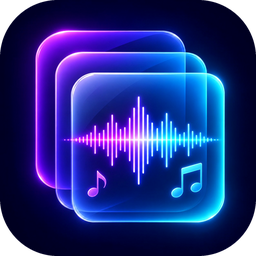
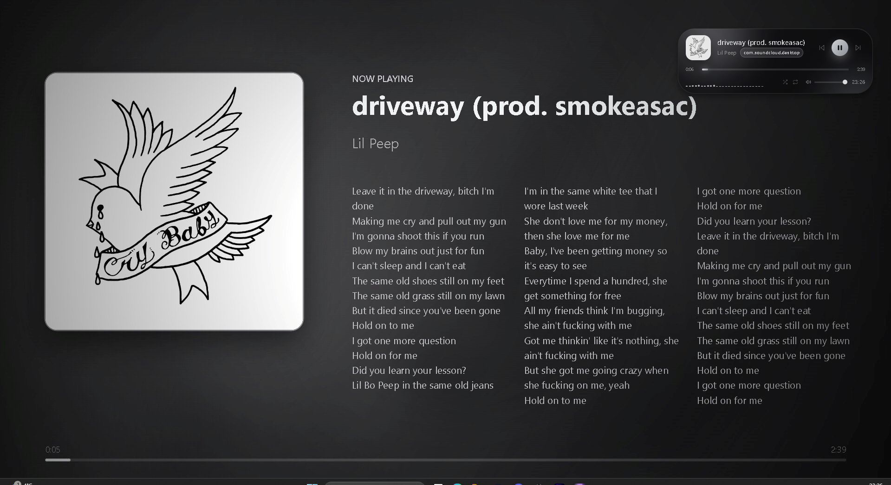
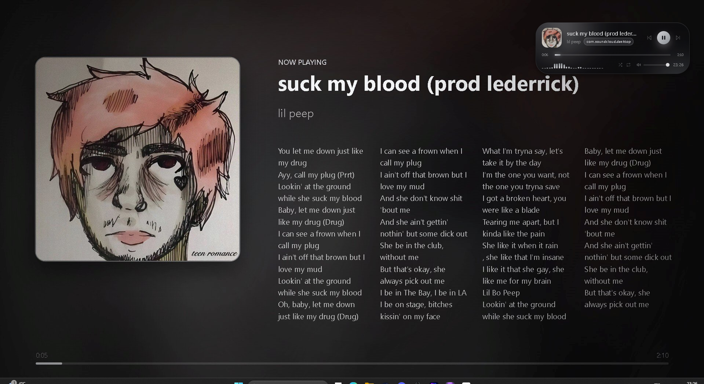
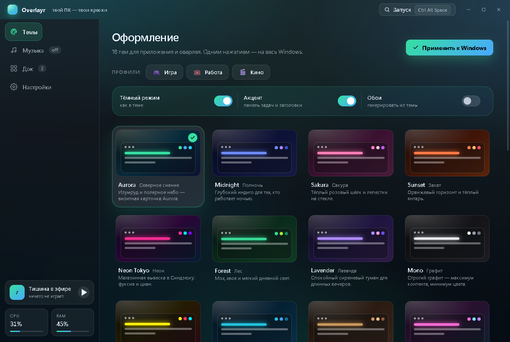
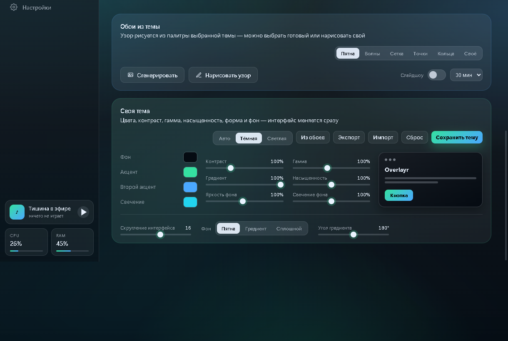
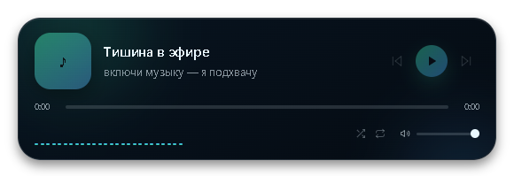
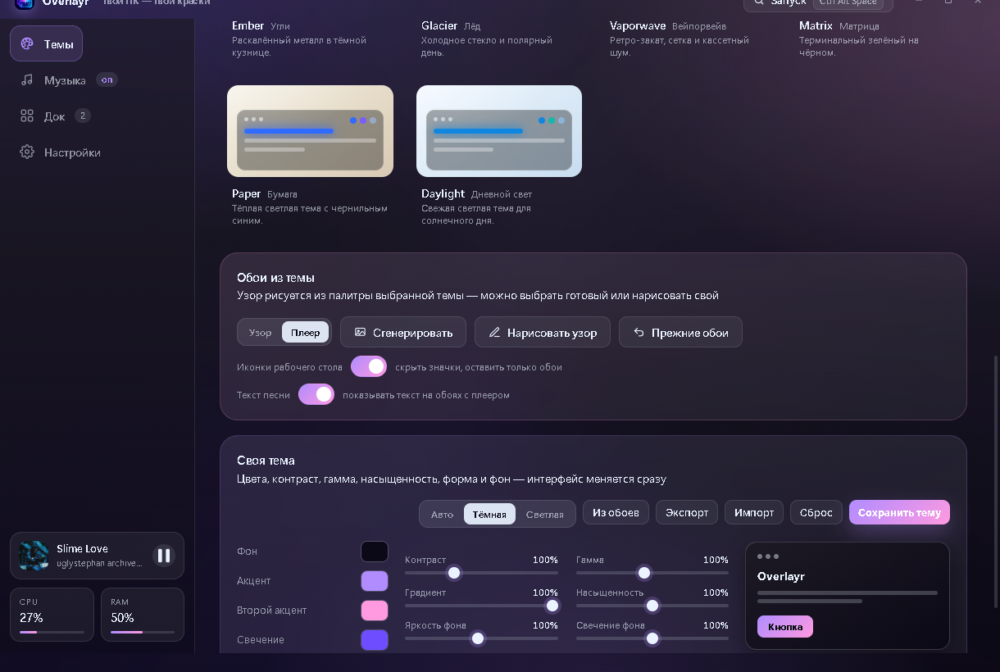
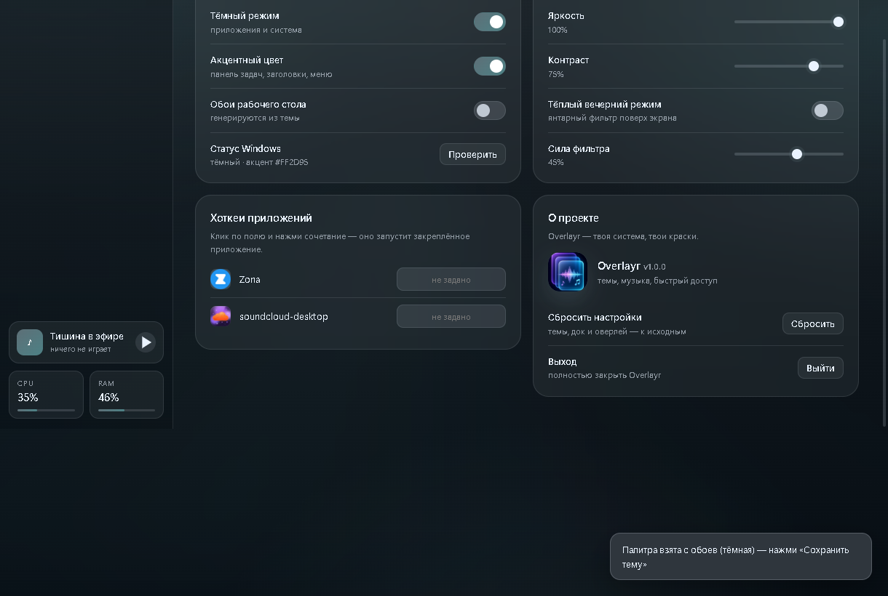
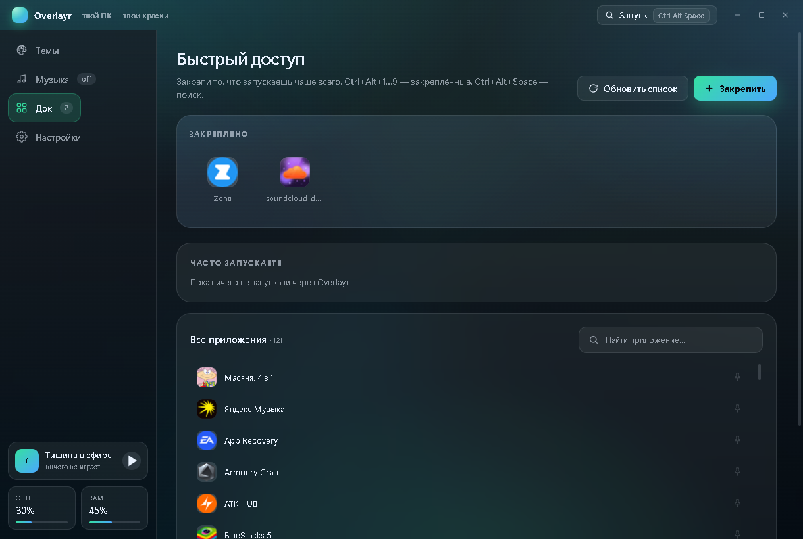
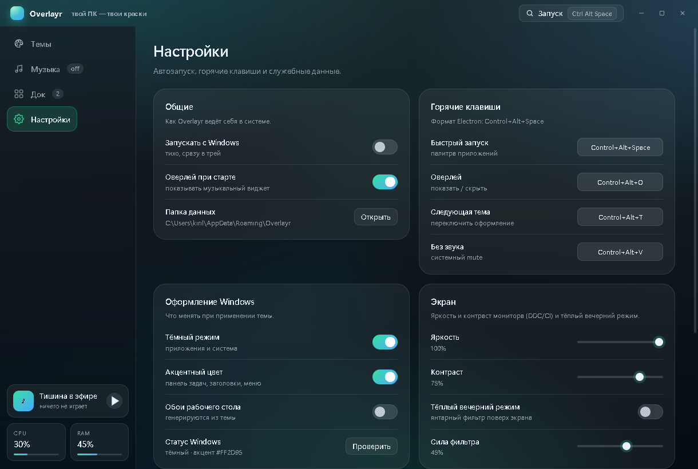

<p align="center">
  
</p>

<h1 align="center">Overlayr</h1>

<p align="center">
  <b>Themes, a now-playing overlay and a live wallpaper for Windows.<br>One small app instead of five settings windows.</b>
</p>

<p align="center">
  <a href="https://github.com/xxzraus/overlayr/stargazers"></a>
  <a href="https://github.com/xxzraus/overlayr/releases"></a>
  <a href="LICENSE"></a>
  
  
</p>

<p align="center">
  <a href="https://www.donationalerts.com/r/xxzraus_creator"><b>❤️ Support the project</b></a>
  ·
  <a href="https://github.com/xxzraus/overlayr/issues/new?template=feature_request.yml"><b>💡 Suggest a feature</b></a>
  ·
  <a href="https://github.com/xxzraus/overlayr/issues"><b>🐞 Report a bug</b></a>
</p>

---



## Table of contents

- [What it does](#what-it-does)
- [Live wallpaper with the current track](#live-wallpaper-with-the-current-track)
- [Themes](#themes)
- [Music overlay](#music-overlay)
- [Wallpaper studio](#wallpaper-studio)
- [Dock and launcher](#dock-and-launcher)
- [Display comfort](#display-comfort)
- [Install](#install)
- [Build from source](#build-from-source)
- [Project layout](#project-layout)
- [Data and privacy](#data-and-privacy)
- [Feedback and ideas](#feedback-and-ideas)
- [Support the project](#support-the-project)
- [Known limitations](#known-limitations)
- [License](#license)

---

## What it does

Overlayr keeps the things you touch all day in one place:

- a **theme** that recolours Windows itself, not only its own window;
- a **music widget** that floats above every window with cover art, seek and per-app volume;
- a **live wallpaper** built from the track that is playing right now — cover, title, artist and the full lyrics;
- generated **desktop wallpapers** in five patterns or your own drawing;
- a **dock** for the apps you actually use, with hotkeys and a spotlight launcher;
- **monitor brightness**, warm evening mode and desktop icon controls.

It is a single portable app: no account, no telemetry, no background services beyond the small native helpers it ships with.

---

## Live wallpaper with the current track

This is the feature people usually notice first. Instead of a static picture, Overlayr paints your desktop from the current song:

- blurred cover as the background;
- a large cover card;
- track title and artist;
- **the whole song text** laid out in 2–4 columns — big enough to read, never covering the entire screen;
- time and a progress bar that keep moving with playback.

The lyrics come with **real timestamps** (LRCLIB, with Genius as a plain-text fallback), so the progress matches the music. The text is optional — there is a **«Lyrics»** switch if you just want the cover.



### How to turn it on

1. Open **Appearance** (or **Settings → Windows appearance**) and enable **«Wallpaper»** — “generate from theme”. This is the master switch: without it Overlayr never touches your desktop.
2. Scroll to **«Wallpaper from theme»** and choose **«Player»** instead of **«Pattern»**.
3. Play something. The wallpaper follows the track automatically and updates when the song changes.

> The cover is fetched in parallel from Genius, iTunes, Deezer and Yandex Music, and the wallpaper waits for it — you should not see a placeholder note while the lookup is running.

---

## Themes



- **18 built-in palettes** — Aurora, Midnight, Sakura, Sunset, Neon Tokyo, Forest, Lavender, Mono, Paper, Daylight, Ember, Glacier, Vaporwave, Matrix and more.
- **Full theme editor**: background, two accents, glow colour, contrast, gamma, gradient, saturation, background brightness, background glow, corner radius, gradient angle and background style.
- **Palette from your wallpaper**, with auto / dark / light modes.
- **Export and import** themes as JSON — share a whole look with one file.
- **Profiles**: Game / Work / Movie switch the theme and overlay behaviour with `Ctrl+Alt+F1…F3`.
- Writes dark mode, accent colour, taskbar and title bar colours to Windows.



---

## Music overlay



- Frameless, always-on-top widget: cover, title, artist, seek, volume, shuffle, repeat.
- **Three sizes** (mini / standard / wide), adjustable width, opacity and corner radius.
- **Collapses into a cover icon** and expands on hover — configurable timing, no accidental hiding.
- **Per-app volume** through CoreAudio: change only the player, not the whole system.
- **Real spectrum analyser** (WASAPI loopback) with bars, wave or circle styles and adjustable sensitivity.
- **Hides itself in fullscreen games** and comes back when you leave them.
- Remembers the last track when a paused player competes with a browser video.
- Live preview in settings and a recent-tracks history.

---

## Wallpaper studio



- Five generated patterns: **blobs, waves, grid, dots, rings**.
- **Draw your own pattern** with a brush; strokes are stored with the theme and reused.
- **Slideshow**: generated wallpapers rotate every 5 / 15 / 30 / 60 minutes.
- **Restore previous wallpaper** with one click — Overlayr remembers what you had before it changed anything.
- **Hide desktop icons** without restarting Explorer.



---

## Dock and launcher



- Scans the Start menu and UWP apps, pulls real icons and filters shortcuts.
- Pin, unpin and reorder apps by dragging; frequent apps show up first.
- `Ctrl+Alt+1…9` for the first nine pinned apps, plus **custom hotkeys for any pinned app**.
- Spotlight launcher on `Ctrl+Alt+Space`.

---

## Display comfort



- **Brightness and contrast** of the primary monitor through DDC/CI (WMI fallback on laptops).
- **Warm evening mode** — an adjustable amber filter for late sessions.
- Desktop icons toggle and startup behaviour next to it.
- **English by default, Russian included** — switch in Settings, applied instantly.

---

## Install

**Installer** — download `Overlayr-Setup-1.3.1.exe` from [Releases](https://github.com/xxzraus/overlayr/releases) and run it. Per-user install, no administrator rights: it goes into `%LOCALAPPDATA%\Programs\Overlayr`, creates Desktop and Start menu shortcuts and adds an uninstall entry.

> The build is not code-signed yet, so SmartScreen may ask for confirmation the first time: **More info → Run anyway**.

**Portable** — download `Overlayr-portable-1.3.1.zip`, unpack anywhere and run `Overlayr.exe`.

---

## Build from source

Requirements: Windows 10/11, Node.js 20+, .NET Framework 4.x (the C# helpers are compiled with the compiler that ships with Windows).

```powershell
npm install
npm run build:tools      # tools\AuroraAudio.exe, AuroraSpectrum.exe, AuroraDisplay.exe
npm start
```

Packaging:

```powershell
npm run build:portable   # dist\Overlayr-win32-x64 + dist\Overlayr-portable-<version>.zip
npm run build:installer  # dist\Overlayr-Setup-<version>.exe  (needs NSIS)
npm run build            # both
```

`build:installer` looks for `makensis` under `.buildtools\nsis\` first and falls back to `PATH`. The portable build stamps the icon and version with [rcedit](https://github.com/electron/rcedit) when it is available in `.buildtools\`. CI (`.github/workflows/build.yml`) builds both artifacts on every tag.

---

## Project layout

```
.
├─ src/
│  ├─ main/            Electron main process
│  │  ├─ main.js       windows, tray, IPC, hotkeys, screenshot harness
│  │  ├─ media.js      GSMTC watcher (PowerShell bridge)
│  │  ├─ audio.js      system and per-app volume
│  │  ├─ artwork.js    covers: Genius, iTunes, Deezer, Yandex Music
│  │  ├─ lyrics.js     timed lyrics from LRCLIB, Genius fallback
│  │  ├─ spectrum.js   WASAPI loopback bridge
│  │  ├─ display.js    brightness, contrast and fullscreen probe
│  │  └─ theme-system.js, apps.js, store.js, preload.js
│  ├─ shared/          themes and colour helpers
│  └─ ui/              main window, overlay, launcher, i18n
├─ scripts/            media.ps1, scan-apps.ps1, theme.ps1
├─ tools/              C# sources and compiled helpers
├─ assets/             icons, installer artwork, welcome card
├─ build/              portable and NSIS build scripts
└─ docs/               screenshots
```

The media watcher, the spectrum analyser and the display helper run as separate long-lived processes, so commands do not pay the PowerShell start-up cost on every call.

---

## Data and privacy

- Settings, custom themes, generated wallpapers, cached covers and lyrics live in `%APPDATA%\Overlayr`.
- No telemetry, no accounts, no analytics.
- Network requests are made only for cover art (Genius, iTunes, Deezer, Yandex Music) and lyrics (LRCLIB, Genius).

---

## Feedback and ideas

Overlayr grows from what people actually miss on their desktop, so **tell us what you want to see next**:

- 💡 [**Suggest a feature or an improvement**](https://github.com/xxzraus/overlayr/issues/new?template=feature_request.yml) — describe what you do every day and what would make it nicer.
- 🐞 [**Report a bug**](https://github.com/xxzraus/overlayr/issues/new?template=bug_report.yml) — include your Windows version and a screenshot if you can.
- ⭐ **Star the repository** if you find it useful — it helps other people find it.
- 💬 Have an idea but no GitHub account? Leave it in [Discussions](https://github.com/xxzraus/overlayr/discussions).

Ideas already on the list live in [ROADMAP.md](ROADMAP.md).

---

## Support the project

Overlayr is free and open source. If it makes your desktop nicer, you can buy the developer a coffee:

<p align="center">
  <a href="https://www.donationalerts.com/r/xxzraus_creator">
    
  </a>
</p>

https://www.donationalerts.com/r/xxzraus_creator

Every donation goes into cover art services, testing hardware and the time it takes to polish the next release. Thank you ❤️

---

## Known limitations

- **Playback queue** is not exposed by Windows through GSMTC, so Overlayr shows a recent-tracks history instead.
- **Per-app volume** is unavailable for players that share the system audio session (for example the UWP Media Player).
- **Spotify and SoundCloud** cover APIs require a registered application key (Spotify refuses anonymous search, SoundCloud requires a client id), so they are not queried. Deezer and Yandex Music cover most of the same catalogue.
- **Brightness and contrast** work for the primary monitor and only if it supports DDC/CI.
- **Fullscreen detection** relies on the foreground window geometry; some exclusive-fullscreen games may not be detected.
- The live wallpaper is a still image refreshed about once per second — Windows has no native animated wallpaper support.
- Lyrics are fetched from public services; instrumental and very obscure tracks may have no text.

---

## Русский

**Overlayr** — темы для Windows, музыкальный оверлей и живые обои в одной программе.

- **Живые обои с плеером**: обложка, название, исполнитель и весь текст песни в колонках, снизу живые время и ползунок. Включается так: **«Оформление» → тумблер «Обои» (генерировать из темы)**, затем в блоке «Обои из темы» выбрать **«Плеер»**. Текст можно отключить тумблером «Текст песни».
- 18 тем и редактор своей темы, палитра из обоев, экспорт/импорт, профили.
- Оверлей: обложка, перемотка, громкость приложения, эквалайзер, сворачивание в иконку, скрытие в играх.
- Узоры обоев, свой рисунок, слайдшоу, возврат прежних обоев и скрытие иконок рабочего стола.
- Английский интерфейс по умолчанию, русский переключается в настройках.

**Идеи и пожелания** — пишите в [Issues](https://github.com/xxzraus/overlayr/issues), мне важно знать, что добавить дальше.
**Поддержать проект** — https://www.donationalerts.com/r/xxzraus_creator

---

## License

[MIT](LICENSE) © Overlayr contributors
